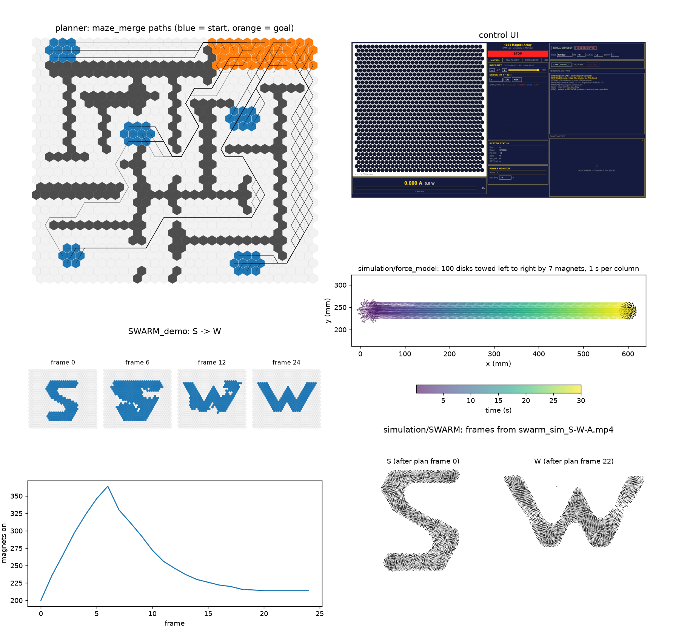
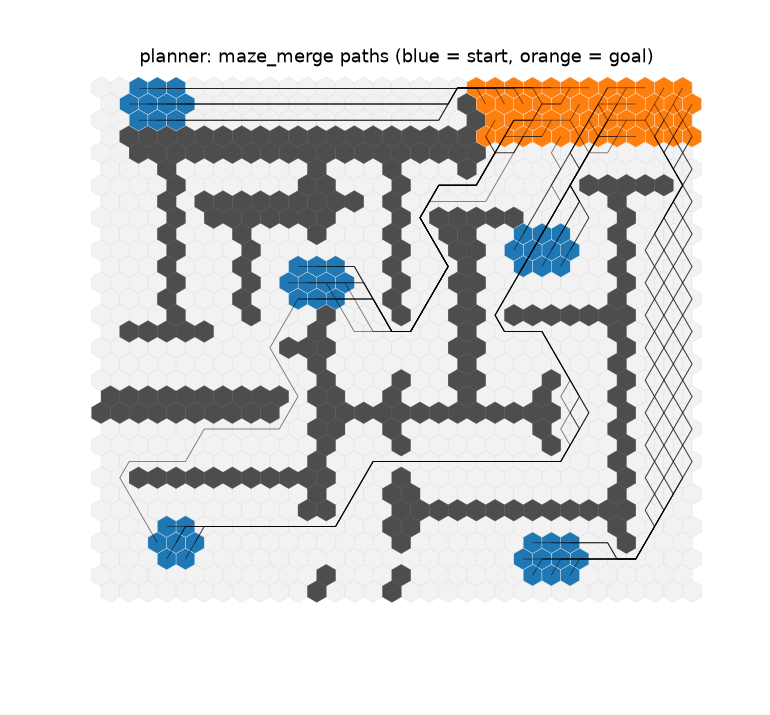
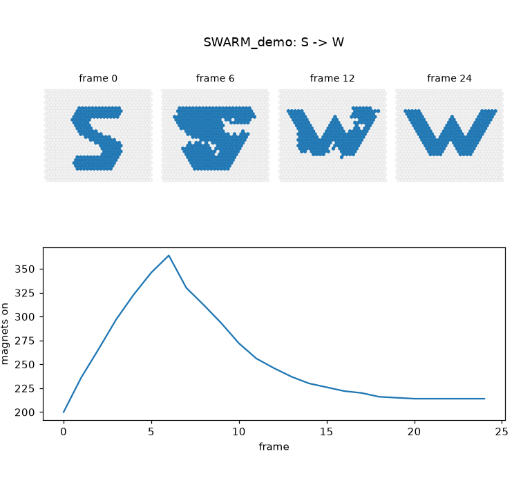
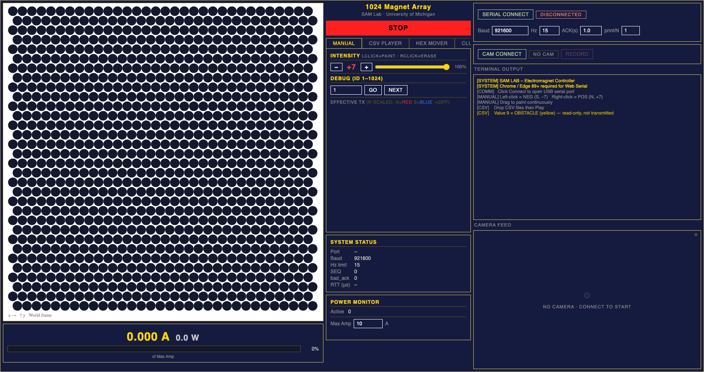
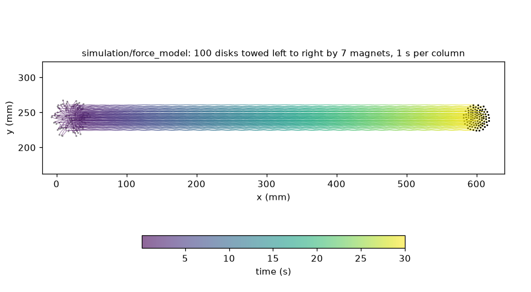
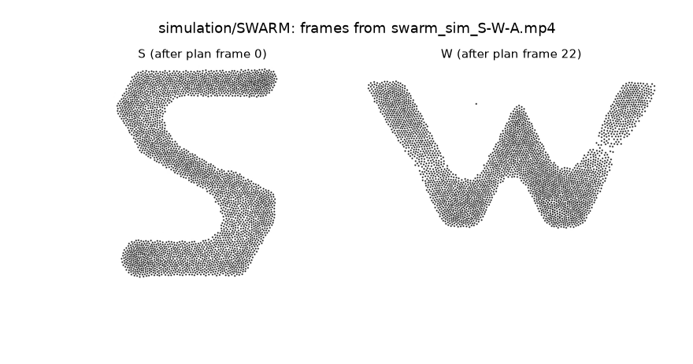

# 1024-magnet microrobot platform: code

| Folder | Contents |
|---|---|
| `firmware/` | Pico firmware and PWM gamma curve |
| `planner/` | Assignment + A* path planner, cluster density |
| `maze_demo/` | Maze transport demo (`maze_merge`) |
| `SWARM_demo/` | Shape-to-shape transform demo (S-W-A-R-M) |
| `simulation/` | Disk physics model and swarm simulation |

## Run

```
pip install -r requirements.txt
python overview.py
```

Needs `ffmpeg`. Writes `overview.png` and `figures/`.

## Figures



**Planner.** Start groups (blue) assigned to goal cells (orange); lines are the A* paths around the walls.



**Shape transform.** Magnet pattern going from S to W, and how many magnets are on in each frame.



**Control UI.** Browser interface that drives the 1024 magnets.



**Transport simulation.** 100 disks towed left to right by a 7-magnet cluster; colour is time.



**Swarm simulation.** 3200 simulated disks settled into the S and W patterns (frames from `simulation/SWARM/swarm_sim_S-W-A.mp4`).


